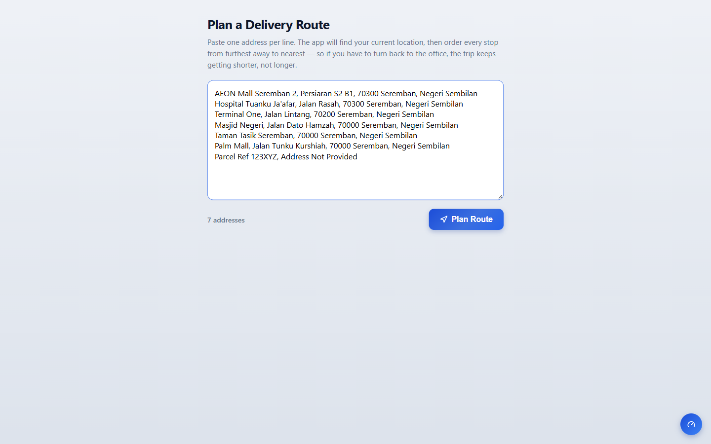
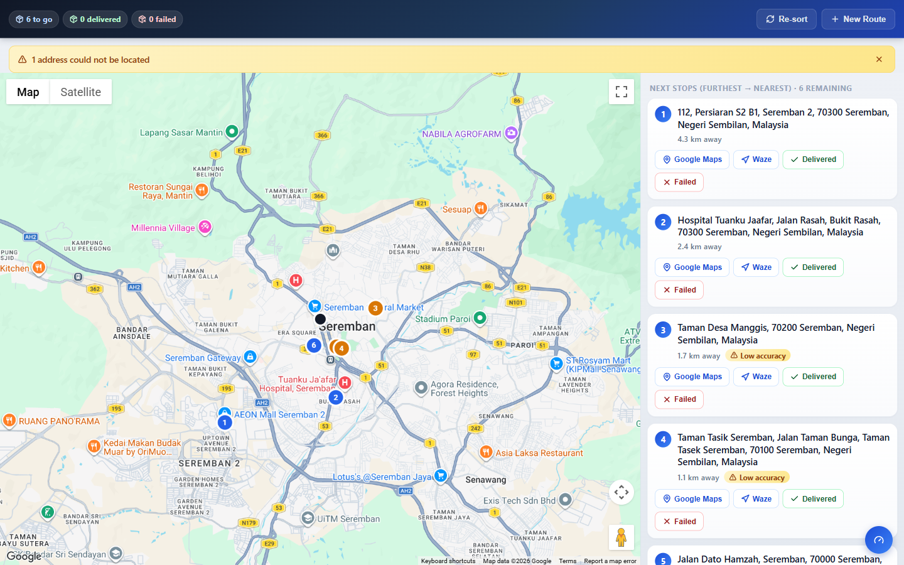
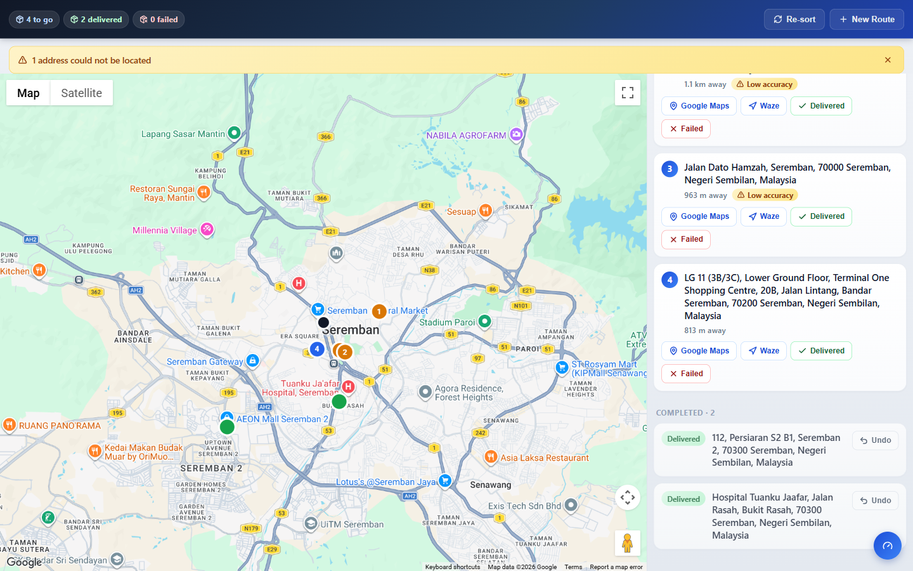
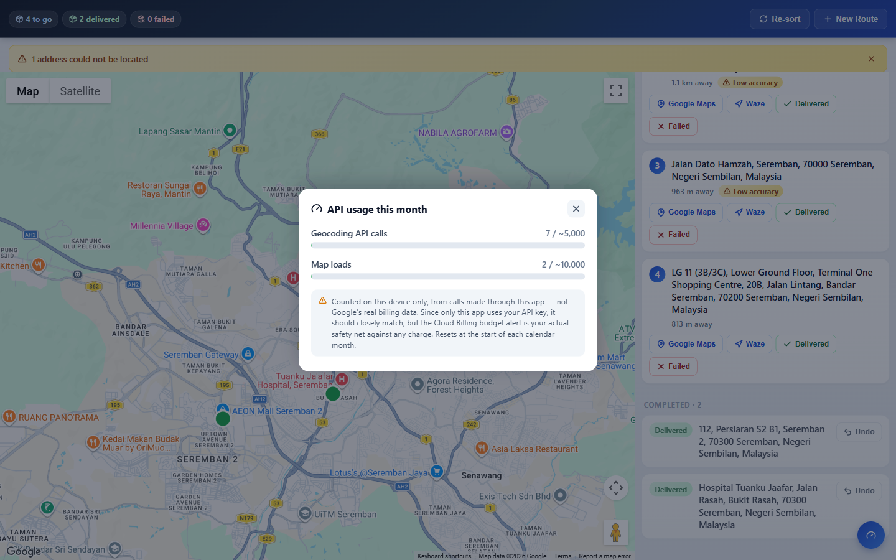

# 📦 Postage & Delivery Route Optimizer

> A mobile-first route planner for a delivery worker: paste a day's addresses, including messy and incomplete Malaysian ones, and get every stop on a map in an order that keeps the way back to the office getting **shorter**, not longer.

**Status:** Private repository. Source code available on request (interviews, review, collaboration).

Runs in the browser as an installable web app, and is also packaged as an Android app.

---

## What it does

1. **Paste addresses in bulk**, one per line, straight from a manifest or a chat.
2. **Find them on the map.** Each address is geocoded with Google Maps; ones that only match after trimming are flagged *low accuracy*, and ones that cannot be found are reported clearly instead of silently dropped.
3. **Order the stops furthest first.** Starting from the worker's GPS position, stops are ordered from furthest to nearest, so if the round has to be abandoned, the remaining trip back keeps getting shorter.
4. **Work the round.** Mark each stop *Delivered* or *Failed* (with undo), re-sort from the current position if the worker has moved off the plan, and pick up where they left off after closing the app.
5. **Stay inside the free tier.** An in-app panel counts this month's Maps and Geocoding calls, backed by a billing budget alert.

---

## Screenshots

| | |
|---|---|
|  **Paste a day's addresses** |  **Route ordered furthest first** |
|  **Mark delivered, with undo** |  **API usage this month** |

---

## Tech stack

- **React 19**, **TypeScript**, **Vite**
- **Google Maps JavaScript API** and **Geocoding** (`@react-google-maps/api`)
- **Progressive Web App**, installable, with a manual update prompt
- **Capacitor** to ship the same build as an Android APK
- `localStorage` for the route, failed lookups and monthly usage counters; no backend, no accounts

---

## Key engineering details

- **Forgiving address matching.** Real addresses arrive with wrong unit numbers or garbled city and state names. When the full string does not match, the geocoder retries with comma-separated parts trimmed from **both** ends, and anything found that way is marked low accuracy for the worker to double-check.
- **A safe way to ship a Maps key with no backend.** The key is restricted to the app's own web origins, which only works through the browser-loaded Maps library, so geocoding goes through `google.maps.Geocoder` rather than the REST endpoint. The allowed origins include the Android WebView's own origin, which differs from the website's.
- **Updates that actually arrive.** Automatic service-worker updates left some phones stuck on old code after a deploy, so updates now use an explicit prompt.
- **Debugged on the real phone.** On-device bugs were found by attaching to the Android WebView's DevTools socket over `adb`, giving live console and network access on the actual handset.
- **Straight-line ordering, by design.** Stops are ordered by straight-line (haversine) distance: it is a delivery strategy, not turn-by-turn navigation.

---

## Interested in the code?

The repository is private. If you would like to see the source, feel free to reach out.
